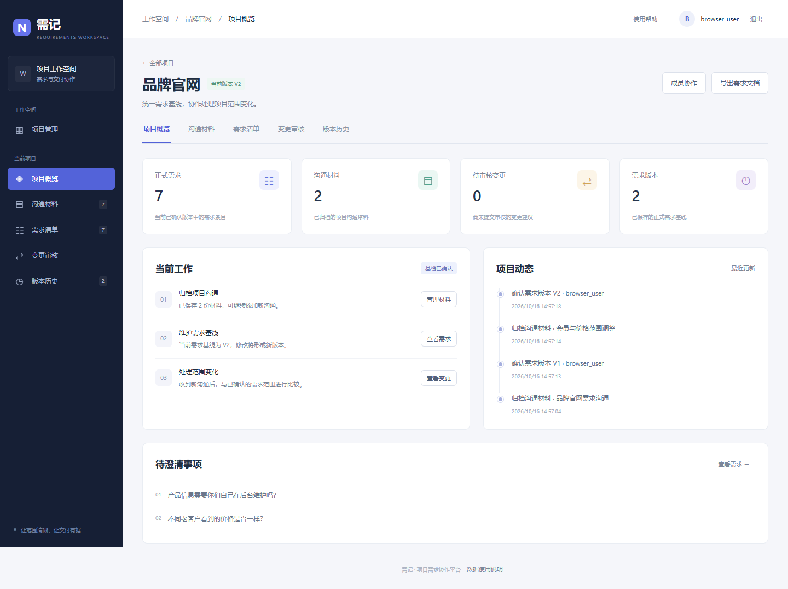
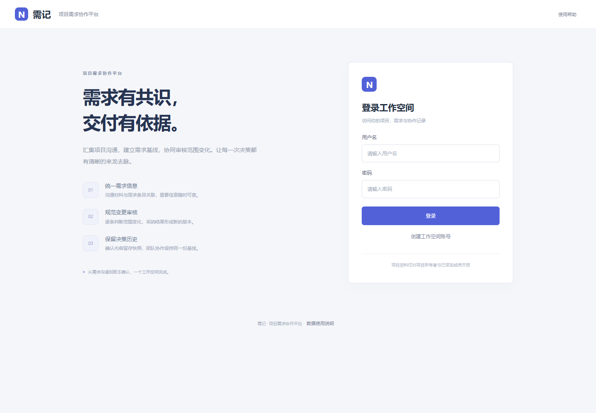
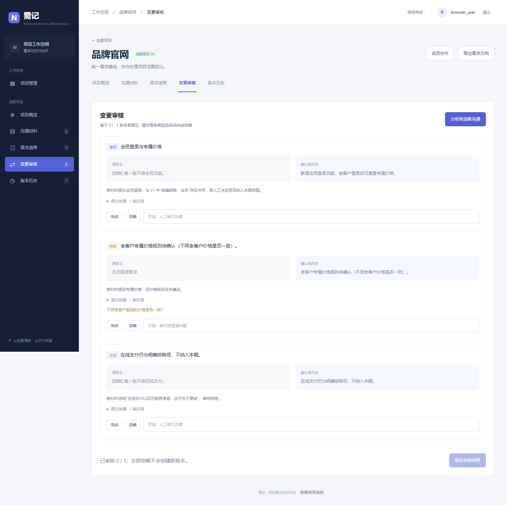
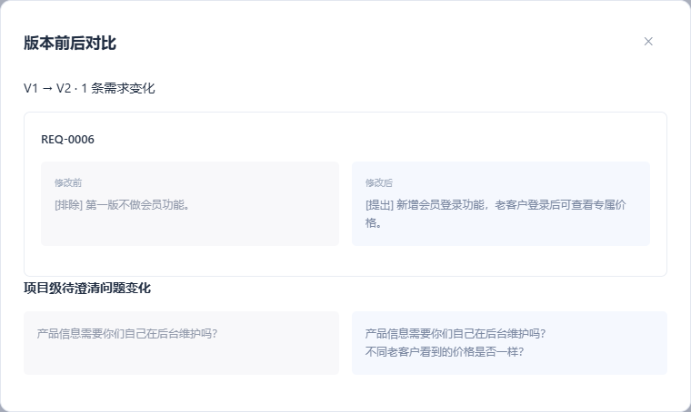

# 需记 · 项目需求协作平台

AI 驱动的项目需求协作平台：从客户沟通中提取带原文依据的需求，识别范围变化，通过人工审核与版本管理形成可追溯的交付基线。

当前版本：**0.3.0** · [更新记录](CHANGELOG.md) · [自动化检查](https://github.com/shienhuisss-cloud/ai-project-manager/actions)

[产品决策](docs/PRODUCT.md) · [模型评测](EVALUATION.md) · [部署](DEPLOY.md) · [演示流程](docs/DEMO.md) · [验证记录](docs/VERIFICATION.md)



## 工作空间

- **项目管理**：项目搜索、基线状态与真实项目统计。
- **项目概览**：正式需求、材料、待审核变更、版本数量与最近项目动态。
- **沟通材料**：归档聊天、会议纪要和邮件，逐条选择需要处理的材料。
- **需求清单**：智能整理或手动录入，关联原文，编辑草稿并确认正式版本。
- **变更审核**：基于正式需求比较新沟通，逐条采纳、修订或忽略。
- **版本历史**：从基线创建修订草稿，保留稳定需求 ID，查看差异、导出文档。
- **成员协作**：项目所有者添加已注册成员，共同维护项目需求。

正式业务界面聚焦项目任务与审核流程，模型服务由后台统一接入。智能整理、人工补充、变更审核和版本确认在同一工作空间完成，固定培训示例与正式业务隔离。



## 解决什么问题

客户在不同聊天中反复提出、否定和修改需求。接单团队不仅要把内容整理出来，还要判断：这是不是本期需求？是否推翻了原来的排除项？新说法有没有真的改变范围？

需记保留原文，将 AI 建议和人工确认分开，并保存每次确认的版本。它帮助团队讨论范围变化，**不把模型输出或项目负责人确认当作客户签署的合同**。

1. 保存沟通原文，按来源、时间和标签勾选本次材料。
2. AI 提取需求、明确排除项、设想与待澄清信息。
3. 人工新增或修改标题、描述、意图、验收条件和问题，保存草稿后确认 V1。
4. 单独选中新沟通，与正式版本语义比较。
5. 对每条变更采纳、修订或忽略；有实际变化才生成 V2。
6. 查看证据、版本前后差异，导出对应版本的 Markdown 文档。



## 产品中的 AI 边界

| 机制 | 解决的风险 | 仍需人工判断 |
| --- | --- | --- |
| 逐字引文、材料归属校验 | 编造来源、引用其他项目 | 原文是否真的支撑这条需求 |
| 明确区分提出/排除/设想/待澄清 | 把未来设想当成本期范围 | 实际承诺与上下文 |
| 结构校验与一次纠错重试 | 非 JSON、错字段、无效需求 ID | 召回是否完整、分类是否合理 |
| 人工确认与不可覆盖版本 | AI 直接修改正式需求 | 是否应接受该变化 |
| 草稿修订检查、过期基线拦截 | 协作时覆盖别人最新修改 | 团队最终确认流程 |

模型通过后端的 Chat Completions 兼容接口接入，支持需求提取与基于版本的变更比较。结构化输出支持 prompt、JSON object、JSON Schema 三种配置；返回内容经过类型、原文引用及关联需求校验，再进入人工审核流程。

调用记录包含模型、提示词版本、总耗时、重试次数和 token 用量；配置单价且各次调用均返回 usage 时估算费用。正式业务分析使用模型返回结果，培训示例通过独立入口提供。



## 本地运行

推荐 **Python 3.12**。先建立独立环境，避免系统 Python 和全局包混用。

```bash
python -m venv .venv
# Windows PowerShell:
.venv\Scripts\Activate.ps1
# macOS/Linux:
# source .venv/bin/activate
python -m pip install -r requirements-lock.txt
python -m uvicorn backend.main:app --host 127.0.0.1 --port 8000
```

打开 http://127.0.0.1:8000 。首次使用点击“创建工作空间账号”，设置用户名和至少 6 位密码，注册后自动登录；以后使用自己注册的账号登录。创建项目、添加沟通材料并勾选后，点击“智能整理”生成需求草稿，核查原文依据并确认正式版本。

### 模型接入

部署管理员在项目根目录（与本 README 同级）将 `.env.example` 复制为 `.env`，配置模型服务；普通业务用户无需操作模型参数。

```powershell
# Windows PowerShell
Copy-Item .env.example .env
```

macOS/Linux 使用 `cp .env.example .env`。如果已经有 `.env`，直接编辑，不要覆盖现有配置。填写服务商提供的兼容地址、密钥、模型名：

```ini
LLM_API_KEY=你的密钥
LLM_BASE_URL=https://api.deepseek.com/v1
LLM_MODEL=deepseek-chat
LLM_RESPONSE_FORMAT=prompt
```

默认 `ENABLE_DEMO_MODE=false`。确需培训演练时，仅在独立培训环境设置为 true，并访问 `/?training=1`；正常登录页不提供示例入口。

配置在重启后加载；环境变量优先于 `.env`。不同服务商对模型名和结构化输出的支持不同，请以所用服务说明为准。密钥不会发送到前端；客户材料会发送给配置的服务商，真实使用前应脱敏。

### 账号与数据

- **首次登录**：系统不提供预设账号，请自行注册工作空间账号。
- **换机器后原来的账号不能登录**：账号与项目存在 `DB_PATH` 指向的本地数据库中，源码仓库不会同步这些业务数据。迁移机器需按 [部署说明](DEPLOY.md) 备份与恢复数据库。
- **配置会上传 GitHub 吗**：`.env`、`.env.*`（模板 `.env.example` 除外）、数据库及备份均被忽略；仓库只提供空配置模板。

模型接入检查、服务运维与备份步骤见 [部署说明](DEPLOY.md)。

## 验证与评测

```bash
python -m pip install -r requirements-dev-lock.txt
python -m pytest -q
python -m ruff check backend tests scripts
python scripts/evaluate.py
```

默认 pytest 执行后端测试，浏览器测试默认跳过。覆盖注册会话、权限隔离、材料选择、草稿修改后冻结、并发基线、幂等权限域、模型校验重试、历史版本导出、迁移保留与失败回滚。

浏览器完整流程：

```bash
python -m playwright install chromium
# Windows PowerShell:
$env:RUN_E2E="1"
python -m pytest tests/e2e -q
# macOS/Linux:
# RUN_E2E=1 python -m pytest tests/e2e -q
```

已安装 Edge 时可设置 `E2E_CHANNEL=msedge`。截图默认输出到 `.artifacts/`；`UPDATE_SCREENSHOTS=1` 更新本文中的实际界面截图。GitHub Actions 在推送后自动运行检查；0.3.0 的后端回归、代码检查、参考答案校验与 Chromium 浏览器流程已在 Ubuntu 上全部通过，见 [远端验证记录](https://github.com/shienhuisss-cloud/ai-project-manager/actions/runs/38880940299)。

`evaluation/cases.json` 包含 30 组合成种子案例，默认评测命令只检查参考答案格式和引文。**真实模型召回率、采纳率、语义准确率仍待测量**；详见 [EVALUATION.md](EVALUATION.md)。

## 实现结构

```text
backend/
  main.py          # HTTP 路由、认证与用例编排
  repository.py    # 项目、材料、草稿、版本、审核记录的数据访问
  storage.py       # 请求独立连接、版本化迁移和外键
  schemas.py       # HTTP 类型与模型 JSON Schema
  changes.py       # 人工决策如何应用到版本副本
  llm.py           # 兼容调用、校验重试、耗时与成本
  validators.py    # 结构、材料引用与关联需求校验
  prompts.py       # 提取和比较提示词，带版本号
  demo.py          # 显式启用培训环境时使用的参考案例，正式模式关闭
  exports.py       # 按目标版本祖先链导出
  backup.py        # 尊重 DB_PATH 的在线备份与恢复
frontend/          # 原生 HTML/CSS/JS，无构建步骤
tests/             # 后端回归、旧库迁移、浏览器完整流程
evaluation/        # 合成种子案例
scripts/evaluate.py
docs/              # 产品决策、演示、真实界面截图
```

FastAPI + SQLite + 原生 JS 控制了个人 MVP 的维护成本。SQLite 使用 WAL、独立请求连接和显式写事务；当前建议单实例单 worker。已有旧库启动时进行一次事务迁移，保留版本快照；无法安全归属的旧幂等记录归档，不再用于返回结果。升级前请备份。

## 发布状态与后续计划

当前为个人项目，尚未发布公开在线地址；界面与工作流程已按正式业务工作空间组织，但没有宣称已通过企业级上线验收。

- 还没有真实用户访谈、试用数据和公开部署，不能声称节省时间或业务增长。
- 合成评测集规模小，需要补充 30–50 组脱敏真实沟通并双人复核。
- 当前支持文本粘贴、智能整理与手动需求维护；语音转写、文件解析、外部聊天工具同步待验证需求后再做。
- 成员均可编辑和确认；暂无成员移除、只读角色、找回密码或企业 SSO。
- 会话放在 sessionStorage，默认同域与 CSP 防护；正式公网服务仍需 HTTPS、持续依赖维护和安全审查。
- 客户确认链接、变更单签署、报价工期影响评估尚未实现。

MIT License。个人项目的价值说明与可使用的简历表述见 [产品说明](docs/PRODUCT.md)，不包含虚构业务数据。
